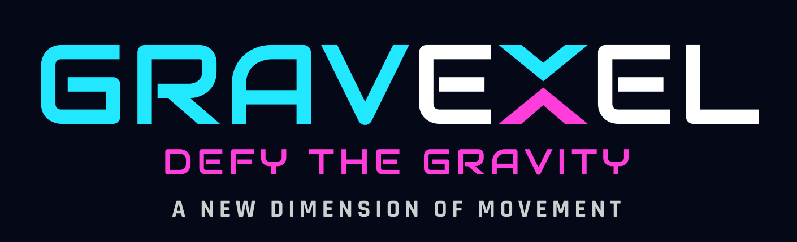

<p align="center"></p>

# GRAVEXEL - Defy the Gravity
*A new dimension of movement.*

A one-button neon platformer: your pixel runs on its own, you flip gravity to switch between floor and ceiling.
56 levels in 6 worlds, 16 unlockable characters, procedural art and music, fully offline.

## Download
Get the latest **Gravexel-Setup-x.y.z.exe** from [Releases](../../releases/latest). Windows 10/11, no extra software.
The game checks for new versions on start and installs them in one click.

## Controls
Space / click / tap: flip gravity · Esc: pause · R: restart · F11: fullscreen

## Project layout
| Folder | What |
|---|---|
| `Unity/` | Unity 2D project (C#). `Assets/Gravexel/Scripts/Core` is the whole game, engine-independent |
| `Desktop/` | Native Windows build of the same core (software renderer, waveOut mixer), `build.sh` |
| `Installer/` | NSIS installer (Windows build) and Inno Setup script (Unity build) |
| `Tools/` | `make_levels.py` level builder, `LevelTool` solver/replay tests, font atlas builder |
| `Brand/` | Logo, app icons, store art (`make_brand.py`) |

## Releasing an update
1. Set the new version in `Unity/Assets/Gravexel/Scripts/Core/GameApp.cs` (`Version = "1.2.0"`).
2. Write the release notes in `CHANGELOG-latest.md`; players see them in the game.
3. `git commit -am "v1.2.0" && git tag v1.2.0 && git push && git push --tags`

GitHub Actions (`.github/workflows/release.yml`) validates every level, builds the EXE and installer, and publishes the release.
Every installed copy then shows **UPDATE AVAILABLE**.

The game looks for releases in `senesikakashi-design/gravexel`. To use a different repository, change `GitHubUpdater.DefaultRepo` (Windows) and `UnityUpdater.Repo` (Unity).

## Build locally (Linux / WSL)
```sh
sudo apt install mono-devel nsis imagemagick zip   # plus .NET SDK 8 and python3-pil
sh Tools/build_tool.sh && mono Tools/LevelTool.exe validate Unity/Assets/Gravexel/Resources/levels.txt
sh Desktop/build.sh            # -> Build/Gravexel-Setup-<version>.exe
```

Fonts: Audiowide and Rajdhani (SIL Open Font License).
